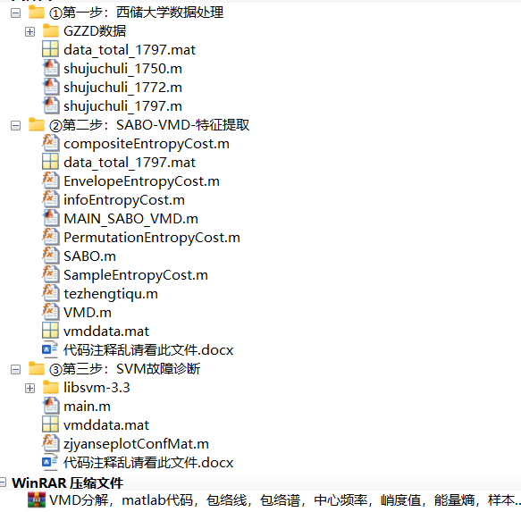
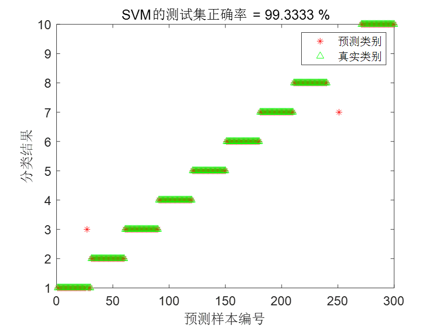
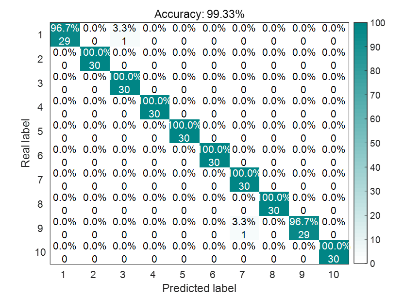

# Superior Tutorial: Bearing Diagnosis with SABO-VMD-SVM at West China University

The process includes data processing, subtraction optimizer SABO algorithm optimization of VMD parameters, and support vector machine fault diagnosis, realizing the whole process of fault diagnosis. Other types of fault diagnosis can refer to this process. Data replacement is very simple!
Similar to the previous article, let's first show you the folder directory, which has been meticulously organized by the author.
As shown in the figure, this time we have completed three tasks:
1. Process the official download of Western Reserve University data as follows:
1. Load a total of 10 data sets, then select the DE_time (%DE is driver-side data, FE is fan-side data, and BA is acceleration data) for each data set.
2. Set the sliding window w, the number of faulty sample points s for each data point, and the sample quantity m for each fault type.
3. After all the data sliding windows are completed, consolidate them into a single data variable.
Regarding the processing of data from Western Reserve University, there was a previous article that discussed it. You can refer to this article: Western Reserve University Bearing Diagnosis Data Processing, Free MATLAB Code Available.
The numbers 1750, 1772, and 1790 in the diagram represent the rotational speeds of bearings at Western Reserve University. When conducting diagnostics, selecting one of these speeds is sufficient; it makes sense to diagnose different faults under the same speed!
Step 2: Feature extraction from the data obtained in the first step of data processing.
Additionally, this article employs the 2023 version of a relatively new and efficient intelligent algorithm—the Subtraction Optimizer (SABO)—to optimize the VMD parameters. It has identified the optimal IMF components for each fault type and utilized the criterion of minimum envelope entropy to extract the best IMF components.
III. Implementing fault classification using Support Vector Machines
This paper adopts the grid search mechanism and uses 5-fold cross-validation to optimize the penalty factor c and gamma parameters of SVM.
Results display
Confusion matrix graph, some articles will adopt this graph:
I must say, the accuracy of the official libSVM package is simply amazing!
Partial code
Data Processing Code:
clc;\nclear;\naddpath(genpath(pwd));\n%DE is the data from the driver side, FE is the fan side data, and BA is the acceleration data. Choose one of them.\nload 97.mat     %Normal\nload 107.mat    % Diameter 0.007 inches, inner ring failure at 1750 RPM\nload 120.mat    % Diameter 0.007, Rolling Bear Fault at Rotational Speed of 1750\nload 132.mat    % Diameter 0.007, outer ring failure at 1750 RPM\nload 171.mat    % Diameter 0.014 inches, inner ring failure at 1750 RPM\nload 187.mat    % Diameter 0.014 inches, rolling element fault at 1750 RPM\nload 199.mat    % Diameter 0.014 inches, outer ring failure at 1750 RPM\nload 211.mat   % Diameter 0.021 inches, inner ring failure at 1750 RPM\nload 224.mat  % Diameter 0.021 inches, rolling element fault at 1750 RPM\nload 236.mat  % Diameter 0.021 inches, outer ring failure at 1750 RPM\nw=1000;                  % w is the size of the sliding window, 1000\ns=2048;                  % Each fault represents 2048 fault points\nm = 10;  % Each type of fault has 120 samples\nD0=[];\nfor i =1:m\n    D0 = [D0,X097_DE_time(1+w*(i-1):w*(i-1)+s)];\nend\nD0 = D0';\nSABOOptimizationVMDCode for parameter and feature extraction:   
%% This program takes a long time to run!\n% vmddata.mat is the final result of feature extraction!\n​\n%% Optimize VMD using SABO algorithm to minimize entropies of minimum enclosing, minimum sample, minimum information, minimum arrangement, and arrange entropy/mutual information entropy, as the objective function (choose one).\nclear\nclc\nclose all\naddpath(genpath(pwd))\nxz = 5;  %xz, select 1, using minimum entropic fitness as the fitness function.\n% Select 2, using the minimum sample entropy as the fitness function.\n% Select 3, using the minimum information entropy as the fitness function.\n% Select 4, using the minimum arrangement entropy as the fitness function.\n% Select 5, using the compound indicator: Arrangement Entropy/Mutual Information Entropy as the fitness function.\nif xz == 1  \n    fobj=@EnvelopeEntropyCost;          % Minimum Entropy\nelseif xz == 2\n    fobj=@SampleEntropyCost;            % Minimum sample entropy\nelseif xz == 3  \n    fobj=@infoEntropyCost;              % Minimum Entropy\nelseif xz == 4\n    fobj=@PermutationEntropyCost;       % Minimum Arrangement Entropy\nelseif xz == 5\n    fobj=@compositeEntropyCost;       % Composite indicator: Arrangement entropy / Mutual information entropy\nend\nload data_total_1797.mat   % Here, we select 10 types of faults with a rotational speed of 1797; you can also choose other types of data.\nD=2;             % Optimize the number of variables\nlb=[100 3];      % Lower limit, which are a, k\nub=[2500 10];        % Upper limit value\nT=20;       % Maximum number of iterations\nN=15;        % Population size\nvmddata = [];\nfor i=1:10   % There are ten fault states\n    disp(['Currently,',num2str(i),'Data for a variety of fault typesVMDOptimization……Please wait patiently.! '])\n    every_data = data(1+120*(i-1):120*i,:);  % A state is 120 samples, each time select 120 samples for VMD optimization and feature extraction.\n    da = every_data(1,:);  % Select a set of data from the current state's data for VMD optimization.\n    [SABOBest_score,SABOBest_pos,Bestidx,SABO_curve] = SABO(N,T,lb,ub,D,fobj,da');\n    display(['1.',num2str(i),'The best data for a specific fault typeVMDParameters are.: ', num2str(fix(SABOBest_pos)),'BestIMFQuantity is: IMF',num2str(Bestidx)]);  % Output the best location\n    %% The following is to bring the best a,k,idx back into VMD and perform 9 types of time-domain feature extraction.\n    bbh = fix(SABOBest_pos);% Best position for integer division\n    new_data = tezhengtiqu(bbh(1),bbh(2),Bestidx,every_data);  %Bring the optimized two parameters and the index value of minimum fitness back to VMD to extract the feature vector of the current state.\n    vmddata =  [vmddata;new_data];  % Collect all the feature vectors extracted from each state\nend\n    save vmddata.mat vmddata  % Save the extracted feature vectors as mat files\n%% Remove the path to avoid confusion with other functions\nrmpath(genpath(pwd))\nSVMDiagnostic code:   
%% Initialization\nclear\nclose all\nclc\nwarning off\n% Data Reading\naddpath(genpath(pwd));\nload vmddata.mat  % Load the preprocessed feature data\ndata = vmddata;\n% Data loading\n​\nbv = 120;    % Each state data has 120 groups\n% Add tag value\nhhh = size(data,2);\nfor i=1:size(data,1)/bv\n    data(1+bv*(i-1):bv*i,hhh+1)=i;\nend\ninput=data(:,1:hhh);\noutput =data(:,end);\njg = bv;   % 120 samples per group\ntn = 90;    % Select the first tn samples for training\ninput_train = []; output_train = [];\ninput_test = []; output_test = [];\nfor i = 1:max(data(:,end))\n    input_train=[input_train;input(1+jg*(i-1):jg*(i-1)+tn,:)];\n    output_train=[output_train;output(1+jg*(i-1):jg*(i-1)+tn,:)];\n    input_test=[input_test;input(jg*(i-1)+tn+1:i*jg,:)];\n    output_test=[output_test;output(jg*(i-1)+tn+1:i*jg,:)];\nend\ninput_train = input_train'; \ninput_test = input_test';\n% Normalization\n[inputn_train,inputps]=mapminmax(input_train);inputn_train = inputn_train';\n[inputn_test,inputtestps]=mapminmax('apply',input_test,inputps); inputn_test =inputn_test';\n[c,g] = meshgrid(-10:0.5:10,-10:0.5:10);  % Adjust the spacing to search more precisely\n[m,n] = size(c);\ncg = zeros(m,n);\neps = 10^(-4);\nv = 5;  % 5-fold cross-validation is adopted.\nbestacc = 0;\n\n  

## Images

<!-- PAYMENT_BLOCK -->

## Get this dataset

- Payment link (Stripe): [Buy now](https://buy.stripe.com/3cs8yP7sY87d0vu9AB)
- Payment QR code: 

<!-- /PAYMENT_BLOCK -->
